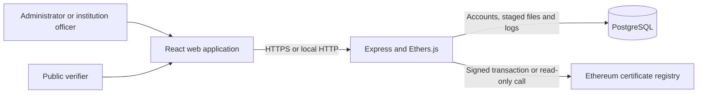

# Architecture and specification

The supplied `Chapters_1_to_3_Dunmoye_Samson_Ayomikun.docx` was read as project documentation. Chapter One defines the academic credential problem and objectives, Chapter Two provides the related-work context, and Chapter Three supplies the implementation and evaluation specification.

## Issuance and recovery

1. Express validates the current institution officer’s session, the ID and the PDF. It confirms that the institution’s wallet is currently approved.
2. Node calculates SHA-256 from the original upload buffer. It also derives a separate Keccak-256 lookup key from the normalized certificate ID. The ID itself is treated as a public reference and should omit personal information.
3. PostgreSQL commits a staging row with the protected PDF, the expected issuer and digest, and the first block to check for a registration event. Staging before submission allows recovery if Ethereum confirms a write just before the API or database fails. The row is visible to staff as pending.
4. Express submits the transaction through the institution’s configured wallet, stores the returned hash, and waits for confirmations. PostgreSQL then commits the confirmed state and audit event in one transaction. The API returns HTTP 201 only after confirmation and database finalization.
5. **Sync / retry** looks up the certificate in a confirmed Ethereum block and verifies issuer and digest before using the registration event to recover its transaction hash. A confirmed revert clears the failed broadcast from the retry path. A known broadcast still missing a receipt remains pending. A retry with no saved hash first checks Ethereum for the existing registration before attempting to submit. Ethereum enforces uniqueness even if requests cross infrastructure boundaries.
6. PostgreSQL advisory locking serializes registry mutations by this API. On-chain roles also constrain calls made outside the web application.

## Verification and permissions

ID lookup, issuer approval and revocation use the same confirmed block. If a file is supplied, a result of Verified File Match requires an exact digest match, a currently approved issuer, and an active certificate. A revoked record takes precedence. An unavailable dependency yields Unable to Verify. Public verification responses omit holder details and certificate bytes. Public uploads are compared in memory and discarded.

An administrator creates institutions and staff accounts, approves or disables institution wallets, reviews records and audit history, and can revoke. An enabled institution officer can see only their institution’s records. Issuance and issuer revocation also require current on-chain approval. Disabling an individual staff account deletes its sessions. Role and institution assignment are set at account creation. Administrators can disable an account and create a replacement with different permissions.

The browser uses an opaque HttpOnly session cookie and the database stores only a hash of its token. The API enforces same-origin write requests, role checks, parameterized queries, upload limits and rate limits. The API process holds signing keys for this demonstration design. Use a dedicated database user, HTTPS, encrypted backups and stricter key custody before handling real institutional records. PDF upload validation checks type, structure and size. Files are stored privately and are never served inline.

| Chapter Three item | Application evidence |
| --- | --- |
| FR1–FR2 | Staff session controls, institution registration, Solidity issuer approval |
| FR3–FR5 | PDF registration, exact-byte SHA-256, confirmed Solidity transaction |
| FR6–FR7 | Public ID / QR route and optional PDF matching |
| FR8 | Revocation by administrator or approved original issuer and an audit trail |
| FR9–FR10 | Distinct results, invalid upload rejection, pending state and service errors |
| Sections 3.8–3.11 | PostgreSQL schema, contract access control, private documents and credentials |
| Sections 3.13–3.14 | Contract, integration and browser tests, plus a manual defence checklist |
